# F1 Live

A self-hosted Formula 1 dashboard for your home network. It shows the next race weekend in
your own time zone and, while a session is running, live timing with a track map: like a
second screen next to the broadcast.

> Unofficial and not affiliated with Formula 1. It reads F1's public live-timing feed, which
> can change without notice. Car positions need your own F1 TV subscription.

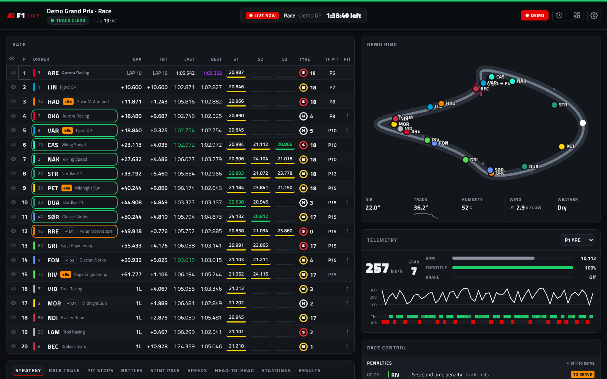

## Screenshots

These show the built-in demo (`DEMO=1`), which uses made-up teams and drivers.

| | |
|---|---|
| 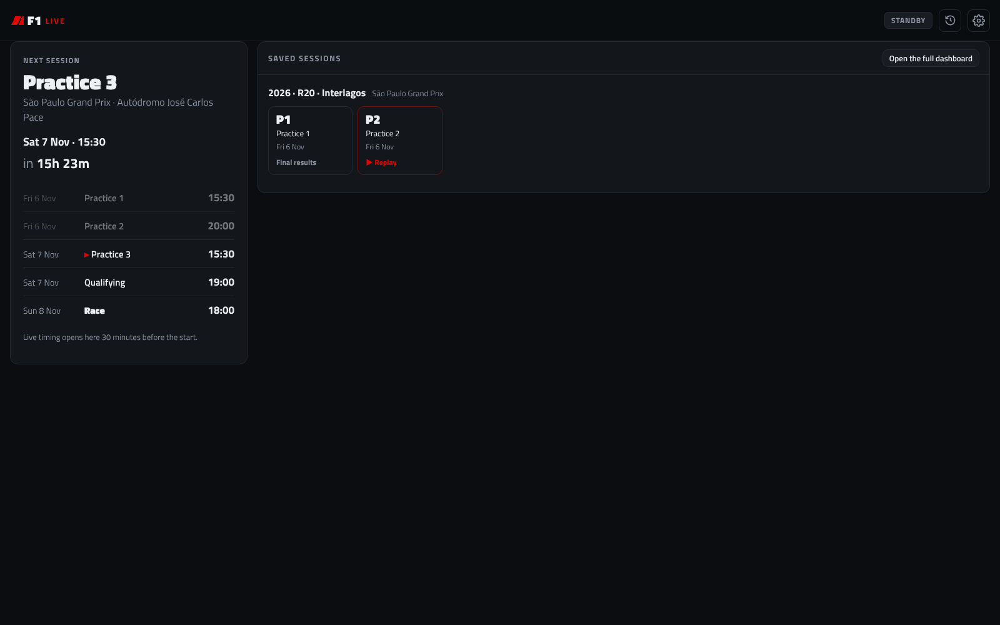 | 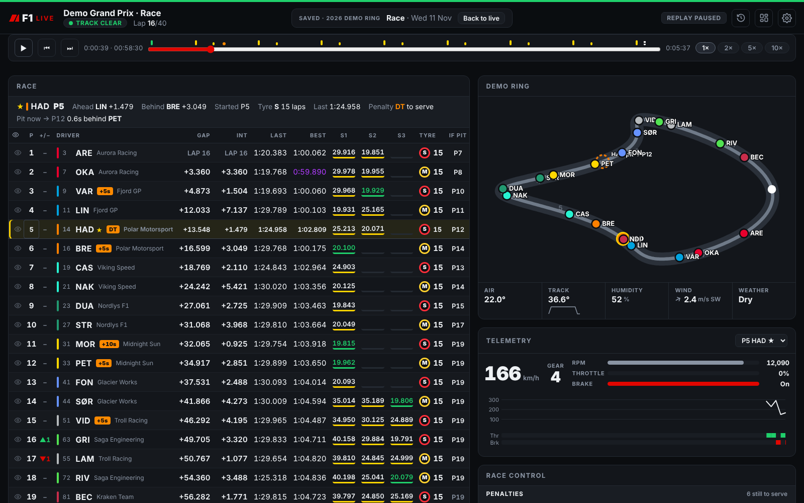 |
| Front page between sessions: next session and saved sessions to replay | Replay: play/pause, timeline and speed |
| 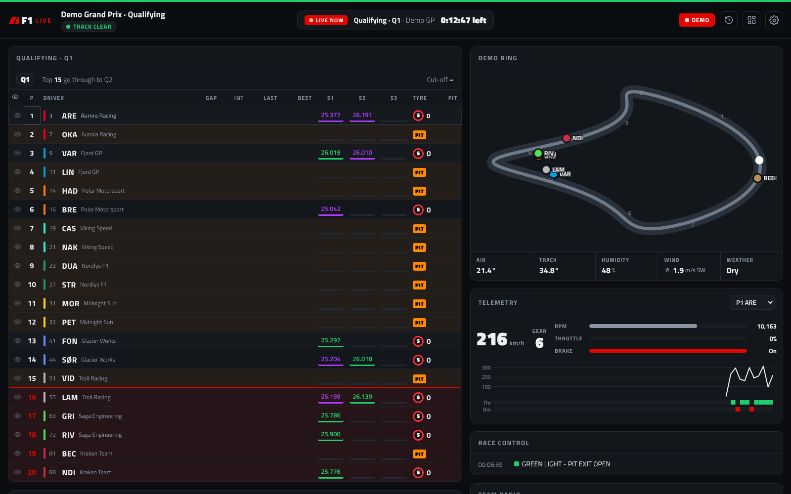 | 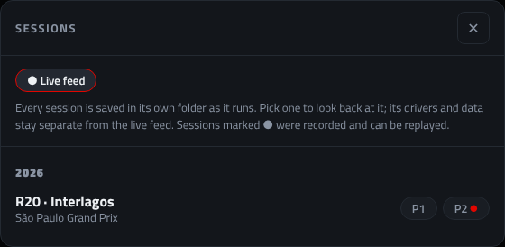 |
| Qualifying: knock-out line and purple/green sectors | Saved sessions by weekend (● = can be replayed) |
| 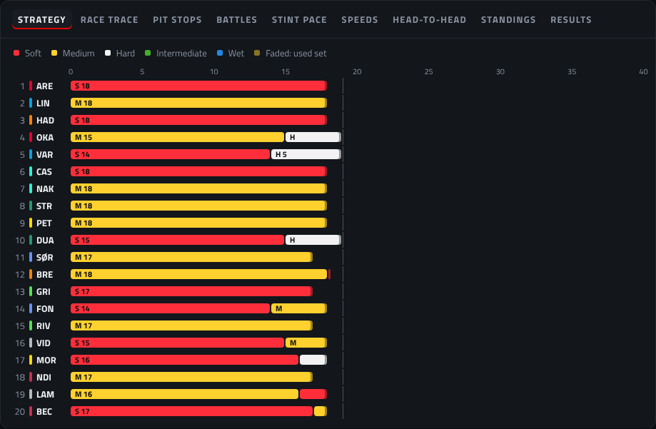 | 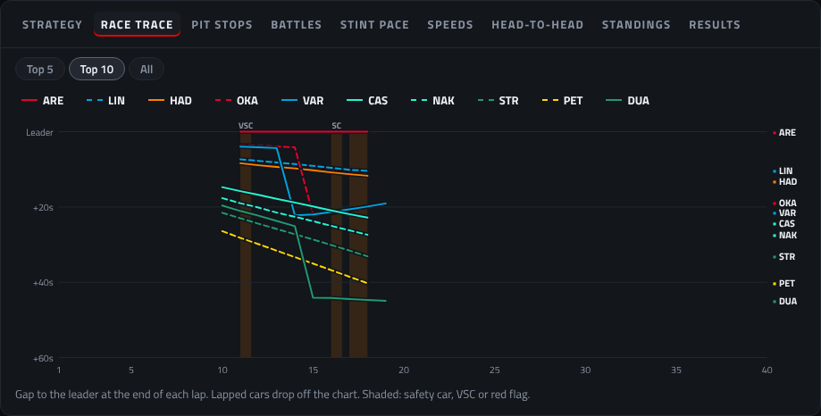 |
| Tyre strategy | Race trace |
| 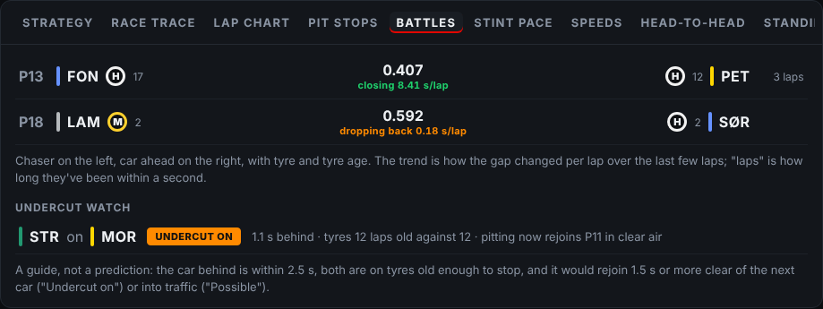 | 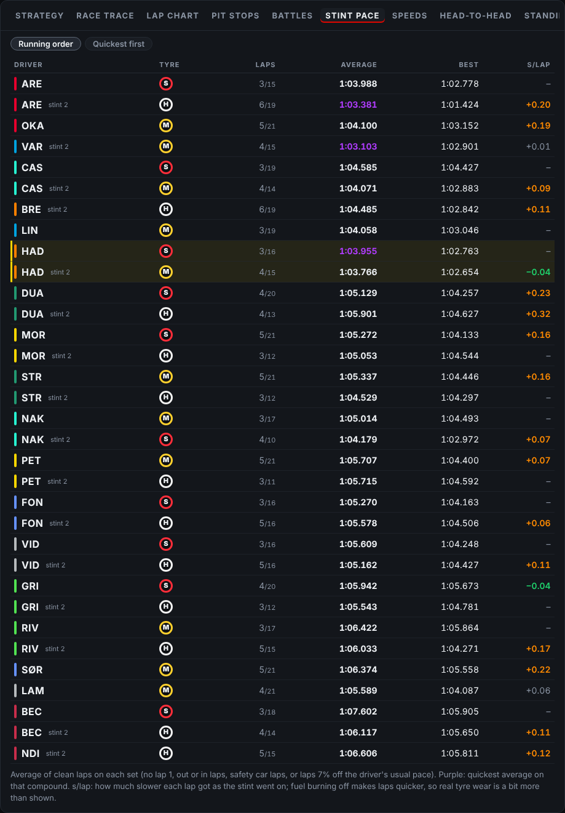 |
| Battles: cars within a second, and whether the gap is closing | Stint pace per set of tyres |
| 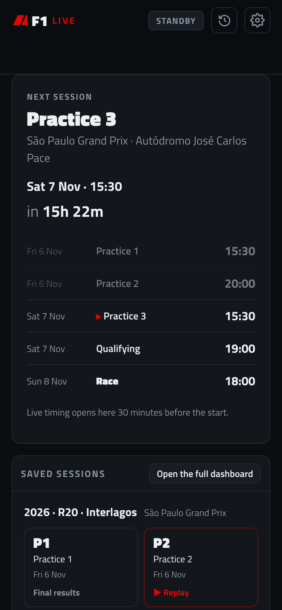 | 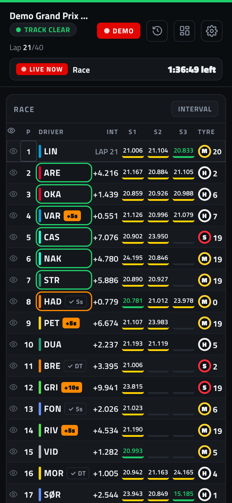 |
| On a phone: front page | On a phone: live race |

Settings: 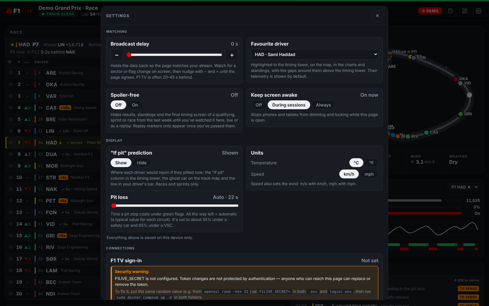

## What it shows

**Between race weekends**
- The next race weekend with every session in your local time, plus a countdown
- Championship standings for drivers and teams
- Results of every race, sprint and qualifying this season
- A calendar feed (`/calendar.ics`) to subscribe to from your phone or computer

**During a session**
- Track status (green, yellow, safety car, VSC, red), shown as a colour bar across the top
- Lap count and a timing tower: positions, gap or interval (tap to switch), last lap
- Sector times, coloured for personal and overall bests
- The session's fastest lap in purple under Best (in qualifying, the fastest of the current part)
- In races and sprints, a green box around a driver who just moved up the order and an orange
  one around a driver who dropped back; each lasts 8 seconds
- Tyre compound, tyre age and pit stops
- Battles (races and sprints): every car within a second of the car ahead, whether the gap is
  closing or growing per lap, both cars' tyres, and how many laps they've been together
- Stint pace: average of clean laps on each set of tyres, best lap, and how lap times drift
  through the stint (lap 1, out/in laps, safety car laps and slow outliers left out)
- Penalties from the stewards (time, drive-through, stop-and-go, grid drops): a badge next to the
  driver and a list at the top of race control, marked served when F1 confirms it
- Race control messages
- A track map with live car positions in team colours, with yellow-flagged sectors highlighted
- Weather: air and track temperature (with trend), humidity, wind and rain
- Weather map: rain radar around the circuit (about 450 km across), with distance rings, how far
  away the nearest rain is and whether it has come closer in the last half hour, the wind at the
  track, and a "Last hour" button that plays the last hour of radar once. A new radar image comes every 10 minutes;
  areas without radar coverage are shaded, and the summary says so when the circuit is in one
- Hourly forecast for the circuit under the weather map, from MET Norway (the forecast behind
  yr.no): rain per hour with its range and chance, temperature and a weather symbol for the next
  8 hours, and when rain is possible or likely to start. It's refreshed about every half hour
- Tyre strategy chart: every driver's stints by compound and length
- Race trace: each driver's gap to the leader lap by lap, with safety car periods shaded
- Team radio clips you can play on the page
- Telemetry for one driver: speed, gear, RPM, throttle and brake (F1 TV only); tap a driver in
  the timing tower to switch
- Live championship standings during races and sprints, with points for the current order
- A favourite driver, highlighted everywhere, with the gaps ahead and behind (⚙ settings)
- Qualifying mode: which part is running (Q1/Q2/Q3, or SQ for sprint qualifying), the
  elimination line and drop zone in the timing tower, the cut-off time, and how much your
  favourite needs to find (or has in hand)
- Pit window: where each driver would rejoin if they pitted now ("If pit" column), with a
  ghost marker on the map for your favourite. The pit loss is a typical value per circuit,
  reduced under a safety car or VSC, and can be set by hand in ⚙ settings
- Pit stop log: every stop with lap, tyre change and time in the pit lane
- Speed traps: each driver's best speed at the intermediate points, finish line and speed trap
- Head-to-head: any two drivers side by side, with lap times and the gap between them lap by lap
- Your own layout: tap the layout button next to ⚙ to move cards up and down, between the
  two columns or hide them. Phones and wide screens keep separate layouts, saved in each browser
- The eye icon in the timing tower hides or shows a driver on the track map
- Units: °C or °F, and km/h or mph (wind in m/s or mph), set in ⚙ settings per browser
- Keep screen awake on phones and tablets: off, during sessions or always (⚙ settings). Needs
  the https:// address, since browsers only allow it on secure pages
- A broadcast-delay slider so the page matches your stream (TV and streaming usually run
  20–45 seconds behind the live data)

The dashboard only connects to F1's feed from 45 minutes before a session until about 90
minutes after it.

Every session is saved in its own folder as it runs, under `data/sessions`:

    data/sessions/2026/R20 - Interlagos/P1/
                                       P2/
                                       Q/
                                       R/

Each folder holds that session's timing state and history (`state.json`, `history.json`) and a
short `info.json`. The ⟲ button in the header lists them by season and weekend; pick one to look
back at it, and "Back to live" returns to the feed. The address keeps the session
(`#s=2026/R20 - Interlagos/P1`), so it can be bookmarked.

**Front page.** Between sessions (from 15 minutes after timing data stops until 30 minutes
before the next session starts) the page shows the next session with a countdown and the
weekend's schedule, plus the saved sessions by weekend, each a tap away from its replay.
"Open the full dashboard" shows the last data instead; the F1 logo goes back to the front page.

**Replay.** Everything F1 sends during a session is also recorded to `feed.jsonl.gz` (plus `feed-2…` after a restart) in its
folder. Sessions marked ● in the picker can be rewatched: play/pause, a timeline to drag, and
1×, 2×, 5× or 10× speed. The whole page plays along (tower, map, telemetry, race control, radio,
charts, and the weather map, which shows each radar image and forecast from the moment it
arrived). A session still running can be replayed from its start too. Recordings are kept for
the last `RECORD_WEEKENDS` weekends (default 3, `0` keeps all); older sessions keep their folder
for looking back, just without the replay. `RECORD=0` turns recording off.

A new session always starts from a clean slate: when F1 moves on to the next session, the one
before is saved to its folder, the page is cleared, and the dashboard reconnects for a full
snapshot of the new one. Drivers who only ran in practice don't carry over into the next session.
Round numbers come from the calendar; session folders are named P1, P2, P3, SQ, S, Q and R.

**Weather map images.** While a session is on, the server saves the radar images around the
circuit to `data/radar` (and the base map once per circuit to `data/basemap`), a few megabytes per
session. Radar images are kept as long as the recordings that show them (`RECORD_WEEKENDS`), and
at least a day. The radar comes from RainViewer's free API, which covers the last two hours (no
forecast) and is meant for personal use.

The race trace is built by the server as laps are completed, so it starts from the first lap
the server sees. If the container restarts mid-race, the laps it missed stay empty.

## Requirements

- A machine running Docker with the Compose plugin
- Optional: an F1 TV subscription, for car positions on the track map and telemetry (F1 only
  sends those to subscribers; everything else works without it)
- Optional: a local DNS name and a reverse proxy for HTTPS

## Install

    git clone <this-repo-url> f1live
    cd f1live
    mkdir -p data && sudo chown 1000:1000 data
    sudo docker compose up -d --build

Open `http://<server-ip>:3080`. To check that it's running:

    curl -s localhost:3080/healthz      # → {"ok":true,...}

### Try it without a race

Set `DEMO=1` in `docker-compose.yml` and run `sudo docker compose up -d`. The page then plays
a simulated race with pit stops and yellow flags. Set it back to `0` afterwards, and delete
`data/last-session.json` so the fake race doesn't linger as the last session.

### A nicer address and HTTPS (optional)

Point a local DNS name at the server (in Pi-hole, your router or a hosts file), then put a
reverse proxy in front. With Caddy:

    f1.example.home.arpa {
        tls internal
        reverse_proxy <server-ip>:3080
    }

Any reverse proxy works. Make sure it doesn't buffer `/api/stream`, which is a live
server-sent events stream.

## Calendar feed

Every session of the season is available as an iCalendar feed:

| Link | What you get |
| --- | --- |
| `/calendar.ics` | All sessions |
| `/calendar.ics?main=1` | Race, qualifying and sprint only |
| `/calendar.ics?alarm=15` | All sessions, with an alert 15 minutes before (any number up to 240) |

⚙ settings has ready-made subscribe links. Add the subscription on each device ("On My
iPhone" or "On My Mac") rather than to iCloud: subscriptions in iCloud are fetched by Apple's
servers, which can't reach a server on your home network. With HTTPS from a local CA, the
device has to trust that CA first.

## F1 TV token (car positions and telemetry)

There are two ways to give the dashboard your token:

1. **Automatically (recommended):** the `login/` folder holds a small companion container
   that signs in to formula1.com with your account, fetches the token and renews it before it
   expires. See [login/README.md](login/README.md).
2. **By hand:** sign in at formula1.com in a desktop browser, open developer tools →
   Application/Storage → Cookies → formula1.com, and copy the value of the `login-session`
   cookie. Paste it in the dashboard under ⚙ settings and click Save. Tokens last a few days,
   so you'll need to repeat this before each race weekend.

Settings shows where the current token came from and when it expires. The token is stored
only in `data/` on your server. If F1 rejects it, the dashboard keeps running without car
positions.

### Protect token changes (recommended)

Without a secret, anyone who can reach the page can replace or remove the saved token (they
can't read it). To lock that down, create `.env` next to `docker-compose.yml`:

    cp .env.example .env
    openssl rand -hex 32        # paste the result after F1LIVE_SECRET=

Put the same value in `login/.env`, then run `sudo docker compose up -d` in both folders. The
page asks for the secret the first time you save or remove a token in a browser, and
remembers it there.

## Configuration

Set these under `environment:` in `docker-compose.yml`, then run `sudo docker compose up -d`
(a plain `docker restart` doesn't pick up changes).

| Variable | Default | What it does |
| --- | --- | --- |
| `DEMO` | `0` | `1` plays a simulated race instead of connecting to F1 |
| `LIVE_ALWAYS` | `0` | `1` stays connected to F1 all the time, not just around sessions |
| `BUFFER_SECONDS` | `150` | How much recent data the server keeps, which caps the broadcast delay |
| `F1LIVE_SECRET` | – | Required to change or remove the token; set it in `.env` (see above) |
| `F1TV_TOKEN` | – | A token to start with (one saved through settings takes priority) |
| `RECORD_WEEKENDS` | `3` | Race weekends whose sessions keep their replay recording (`0` = all) |
| `RECORD` | `1` | `0` turns recording for replay off |
| `RADAR` | `1` | `0` turns the weather map's radar off (nothing is fetched or saved) |
| `FORECAST` | `1` | `0` turns the hourly forecast from MET Norway off |
| `MET_USER_AGENT` | `f1-home-dashboard/1.0 (+https://github.com/AteaHelland/F1Live)` | How the dashboard identifies itself to MET Norway, which asks for an app name and a way to contact you; put your own website or email here if you like |
| `DATA_DIR` | `./data` | Where the calendar, track outlines, saved sessions and token are kept |
| `DEMO_SPEED` | `1` | In demo mode, runs the simulated session faster (e.g. `8`) to fill the charts quickly; lap times look odd at high speeds |
| `DEMO_SESSION` | `race` | In demo mode, `quali` plays a qualifying session instead of a race |
| `JOLPICA_URL` | `https://api.jolpi.ca/ergast/f1` | Calendar, standings and results API (change only for testing) |
| `RAINVIEWER_URL` | `https://api.rainviewer.com` | Rain radar API (change only for testing) |
| `BASEMAP_URL` | CARTO dark map tiles | Base map tile address with `{z}`, `{x}` and `{y}` (change only for testing) |
| `MET_URL` | `https://api.met.no/weatherapi` | MET Norway's API (change only for testing) |

## Updating

    git pull
    sudo docker compose build --pull
    sudo docker compose up -d

The image is built locally, so `docker compose pull` alone won't update it. After an update,
reload the page in your browser.

## Monitoring (optional)

- Health check: `http://<server-ip>:3080/healthz`, for Uptime Kuma, Homepage or similar
- The auto sign-in container has its own status check, described in `login/README.md`

## Data sources

- Live timing: livetiming.formula1.com (unofficial)
- Race calendar, standings and results: api.jolpi.ca (Ergast-compatible)
- Team radio clips: played straight from livetiming.formula1.com
- Track outlines: MultiViewer's public circuit API
- Rain radar: [RainViewer](https://www.rainviewer.com/) (free API for personal use)
- Hourly forecast: [MET Norway](https://api.met.no/) Locationforecast, the data behind
  [yr.no](https://www.yr.no/)
- Weather map background: © [OpenStreetMap](https://www.openstreetmap.org/copyright) contributors,
  © [CARTO](https://carto.com/attributions)

To try the weather map without internet access, run `node test/fake-radar.js` and start the
dashboard with `RAINVIEWER_URL=http://localhost:3098` and
`BASEMAP_URL='http://localhost:3098/base/{z}/{x}/{y}.png'` (and `MET_URL=http://localhost:3098/weatherapi`
for a made-up forecast).

## Keep secrets out of git

`data/` (your token), `.env` (your secret) and `login/.env` (your F1 password) are listed in
`.gitignore`. Check
`git status` before committing, and don't put a real token in `docker-compose.yml`.
